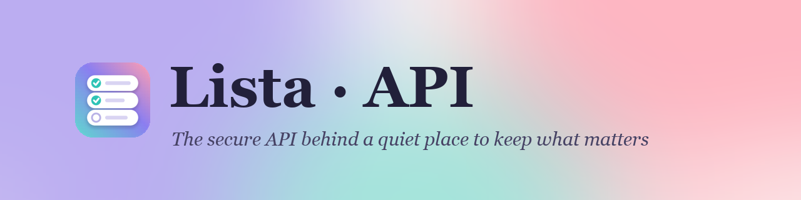

<p align="center">
  
</p>

<p align="center">
  The backend of <b>Lista 2</b>: it stores the lists, decides who may see or change them, keeps the pictures and sends password-reset emails.
</p>

<p align="center">
  <a href="https://listaa2.netlify.app/Login"><b>▶ Open Lista</b></a> &nbsp;·&nbsp;
  <a href="docs/api-reference.md">API reference</a> &nbsp;·&nbsp;
  <a href="docs/features.md#lista-1-compared-with-lista-2">What's new</a> &nbsp;·&nbsp;
  <a href="https://github.com/coralingberlandau/lista2_frontend">Frontend</a>
</p>

<p align="center">
  
  
  
  
</p>

<p align="center">
  
  
  
</p>
<p align="center"><sub>Screens served by this API.</sub></p>

<p align="center"><sub>Live API: <code>https://coral8.pythonanywhere.com</code> (API only: a "login required" message means it is running)</sub></p>

---

## ✨ What the API Does

<table>
<tr>
<td width="33%" valign="top">

### ✍️ Create and save
Lists of items with optional pictures on any row. A list can be a title alone. Deleting only hides a list.

</td>
<td width="33%" valign="top">

### 🤝 Share safely
**Read-Only** or **Full Access** per person, enforced by the server on every request.

</td>
<td width="33%" valign="top">

### 🖼️ Pictures
Saved together with the list, **all or nothing**, and checked to be real pictures.

</td>
</tr>
<tr>
<td valign="top">

### 🔐 Accounts
Sign-up with a username, an email and a password; login; session renewal; private profiles.

</td>
<td valign="top">

### ✉️ Password reset
A single-use email link that expires after one hour.

</td>
<td valign="top">

### 🎨 Personalize
Each person keeps their own background.

</td>
</tr>
</table>

---

## 🧭 Capabilities at a Glance

**Legend:** ✅ already in Lista 1 &nbsp;·&nbsp; ⬆️ in Lista 1 and improved in Lista 2 &nbsp;·&nbsp; 🆕 new in Lista 2 &nbsp;·&nbsp; 🔁 changed in Lista 2

| | Feature | Status | In short |
|:-:|---|:-:|---|
| 👤 | **Registration and login (JWT)** | ⬆️ | Now only a username, an email and a password are required |
| 🔄 | **Session renewal** | 🆕 | 25-minute access token plus a 90-day rotating refresh token |
| 🔑 | **Password rules** | 🆕 | Strength rules at sign-up and when resetting |
| ✉️ | **Password reset by email** | ⬆️ | Now a single-use link that expires after one hour, sent through Brevo (it was SendGrid) |
| 📝 | **Lists: create, update, hide** | ⬆️ | Deleting only hides a list. Now a list may be just a title, and every list reports its picture rows |
| 🤝 | **Sharing with Read-Only or Full Access** | ⬆️ | Now enforced by the server on every list and picture request |
| 🖼️ | **Pictures** | ⬆️ | Now one all-or-nothing save, real JPEG, PNG or WebP only, and files cleaned up |
| 🎨 | **Per-person backgrounds** | ✅ | Each person keeps their own |
| 🙋 | **Profile** | ⬆️ | Read and edit your own profile only; the names are optional |
| 💡 | **AI ideas** | 🔁 | Were generated by the backend with OpenAI; now by Google Gemini through a Netlify function, so no AI key lives on this server |
| 🛡️ | **Login required by default** | 🆕 | Only sign-up, login, token refresh, password reset and reading a list's pictures are public |
| 🧾 | **Safe logs** | 🆕 | Tokens, passwords and Authorization headers are redacted |
| ⚙️ | **Configuration** | 🆕 | Settings and keys come from environment variables; debug is off by default |
| ✅ | **Automated tests** | 🆕 | 73 tests and a dependency audit before every release |
| ☁️ | **Hosting** | 🔁 | PythonAnywhere with a persistent disk (it was Render's free tier, which needed to be woken up before use) |

More detail, including everything Lista 1 offered, is in the [capabilities guide](docs/features.md).

---

## 🆕 What's New in Lista 2

Lista 1 already had accounts, lists, sharing, pictures, backgrounds, AI ideas and password reset. Lista 2 keeps all of that and rebuilds what is behind it:

- **Security first:** login required by default, permissions checked on the server, rotating refresh tokens, single-use reset links
- **Safer pictures:** one all-or-nothing save, real image types only, files cleaned up
- **Simpler sign-up:** only a username, an email and a password are required
- **No secrets in the code:** everything comes from environment variables
- **73 automated tests** and a dependency audit before every release

The [full comparison](docs/features.md#lista-1-compared-with-lista-2) lists every difference.

---

## 👥 About Lista

**Goals:** an intuitive app for managing lists on every device; collaboration with clear permissions; productive, seamless tools; a personalized experience; and user data kept safe. **Made for:** individuals, groups managing projects or events, and anyone who shares information with tailored permissions. [Read more](docs/about.md).

---

## 📚 Documentation

| | Page | What you will find |
|:-:|---|---|
| 🧭 | [Capabilities](docs/features.md) | Everything the API does, what came from Lista 1 and what is new |
| 🔌 | [API reference](docs/api-reference.md) | Every endpoint, with examples |
| 🏗️ | [Architecture](docs/architecture.md) | How the parts fit together, and the technology |
| 🔐 | [Security](docs/security.md) | Access rules, sessions and permissions |
| 🗃️ | [Data model](docs/data-model.md) | Users, lists, sharing, pictures and backgrounds |
| ⚙️ | [Configuration](docs/configuration.md) | The environment variables |
| ✉️ | [Email and password reset](docs/email-and-password-reset.md) | How reset links work |
| 🧪 | [Testing and quality](docs/testing-and-quality.md) | The 73 tests, code quality and logging |
| 🚀 | [Getting started](docs/getting-started.md) | Run it locally and deploy to PythonAnywhere |
| 🗺️ | [Roadmap](docs/roadmap.md) | What is planned |

---

## 🚀 Quick Start

```bash
pip install -r requirements.txt
cp .env.example myproj/.env      # then set SECRET_KEY and DEBUG=True
python manage.py migrate
python manage.py runserver
```

The API is then at `http://localhost:8000`. See [Getting started](docs/getting-started.md).

## 🤝 Contributing

Fork, create a branch (`feature/your-feature-name`), make your change with a **clear commit message that says what changed and why**, run `python manage.py test lista`, and open a pull request.

<div align="center">

---

**Backend** · [Frontend repository](https://github.com/coralingberlandau/lista2_frontend) · [Live app](https://listaa2.netlify.app/Login)  
📧 Questions or feedback: **listaassistance@gmail.com**

*Thank you for exploring Lista. We hope it makes your life easier and more organized.* 😊

</div>
