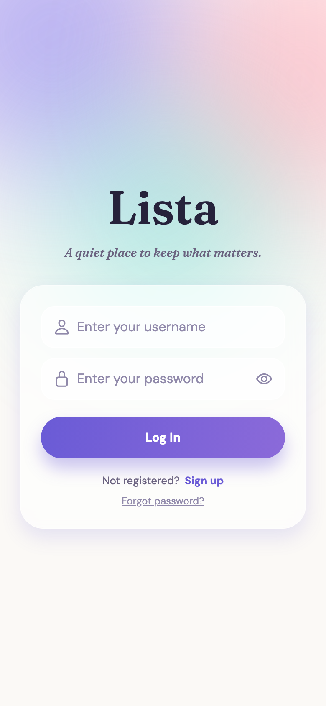
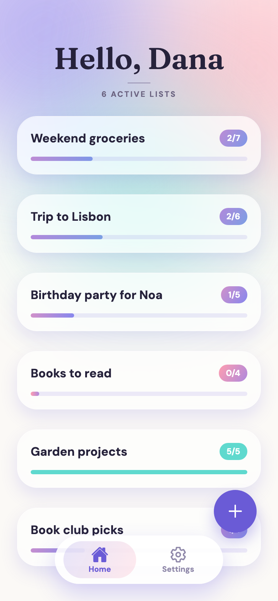
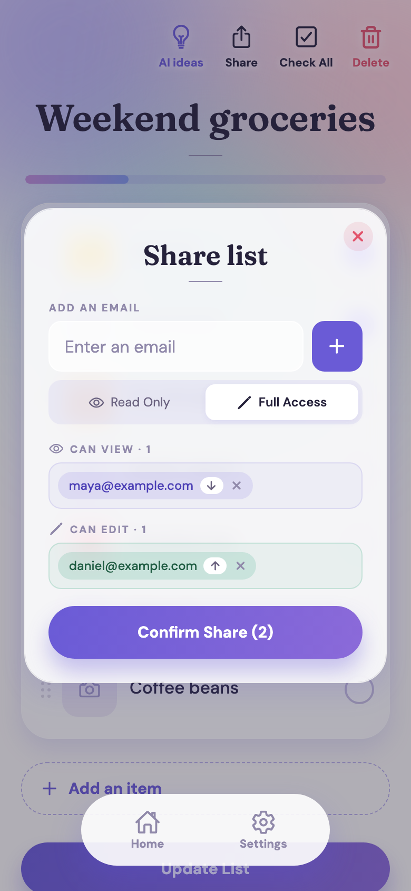
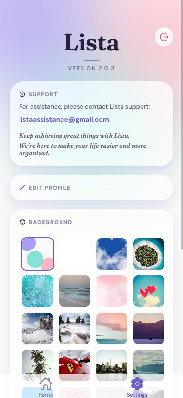

# **Welcome to Application LISTA - Backend** 👋  

## **Lista - Personal and Collaborative List Management App**  

The backend of **Lista**, a personal and collaborative list management app, 
is built to deliver seamless, secure, and efficient functionalities.
This is **Lista 2**: a tested, permission-aware REST API that powers the app, 
sends password-reset emails and is ready for production.
Below is the detailed README for setting up and contributing to this project.

<p align="center">
  
  
  
</p>

*The screens above are served by this API: login, the lists on Home, and sharing with permissions.*

--- 

## **📋 Overview**  
**Lista** is your ultimate solution for organizing and managing personal and shared lists. 
The backend provides secure authentication, list and permission management, image storage, 
background customization and transactional email, all through a REST API.


  

---


### 🔗 **Backend URL - PythonAnywhere**:  
✨ [Access the backend here!](https://YOUR-USERNAME.pythonanywhere.com) ✨  
*(replace with your PythonAnywhere address after deployment)*


### 🌐 **Frontend URL - Netlify**:  
✨ [Access the frontend here!](https://YOUR-SITE.netlify.app/Login) ✨  
*(replace with your Netlify address after deployment)*

---

## **To Do List:**  

- **Environment Setup - ENV :** Done  
- **Security hardening:** Done  
- **Automated tests:** Done  
- **Email provider (Brevo):** Done  
- **Deployment on PythonAnywhere:** see [Deployment](#deployment)

---

## **Database:**  
- **SQLite** (`db.sqlite3`). The database file is **not** stored in Git; it lives on the server's persistent disk. 
  A fresh database is created with `python manage.py migrate`.

---
## **Table of Contents**  
1. [Introduction](#introduction)  
2. [Project Goals](#project-goals)  
3. [Target Audience](#target-audience)  
4. [Architecture](#architecture)  
5. [Security and Reliability at a Glance](#security-and-reliability-at-a-glance)  
6. [Technologies Stack](#-technological-stack)  
7. [Key Features](#key-features)  
8. [Screens](#screens)  
9. [Database Models](#database-models)  
10. [Authentication and Security](#authentication-and-security)  
11. [Configuration](#configuration)  
12. [Email and Password Reset](#email-and-password-reset)  
13. [AI Suggestions](#ai-suggestions)  
14. [API Endpoints](#api-endpoints)  
15. [Installation and Setup](#installation-and-setup)  
16. [Deployment](#deployment)  
17. [Testing](#testing)  
18. [Code Quality and Logging](#code-quality-and-logging)  
19. [Development Process](#development-process)  
20. [CRUD Status](#crud-status)  
21. [Future Plans](#future-upgrades)  
22. [Contributing](#-contributing)  

---

## **Introduction**  
The idea for **Lista** arose from a daily need to organize, manage, and track 
lists and tasks effortlessly.  
**Lista** provides an all-in-one solution that combines personal and collaborative 
list management with customizable design.
The backend is developed using **Django REST Framework**, ensuring robustness and 
scalability. It supports secure user 
authentication, list sharing with permissions, and image and background storage.

---

## **Project Goals**  
- Create an intuitive application for managing lists, compatible with all devices 
(mobile and desktop).  
- Enable collaboration, editing, and sharing of lists with clear permissions.  
- Provide user-friendly tools for productive and seamless management.  
- Deliver a highly personalized user experience.  
- Keep user data safe: authenticated access, per-list permissions and no secrets in the code.  

---

## **Target Audience**  
- **Individuals**: People looking to organize personal lists and tasks.  
- **Groups**: Teams managing projects, events, or activities collaboratively.  
- **Organized Users**: People who need to share and manage information efficiently 
with tailored permissions.  

---

## **Architecture**  


| Part | Where it runs | Role |
|------|---------------|------|
| **Frontend** (separate repository) | Netlify | React Native + Expo web app: every screen, session renewal and error messages |
| **Backend API** (this repository) | PythonAnywhere | Django REST Framework: accounts, lists, sharing and permissions, images, backgrounds, password reset |
| **Database and files** | PythonAnywhere persistent disk | SQLite database and uploaded images |
| **Email** | Brevo web API | Sends the password-reset email |
| **AI suggestions** | Netlify function + Google Gemini | Lives in the frontend project; this API is not involved |

**How a request flows**
1. The app sends an HTTPS request with `Authorization: Bearer <access token>`.  
2. Django REST Framework checks the token: **every endpoint requires a login unless it is explicitly public**.  
3. The view checks **who may do what** on that list (owner, Full Access, Read-Only), then reads or writes the database.  
4. The request is logged with tokens, cookies and passwords redacted.  
5. When the short-lived access token expires, the app swaps its refresh token at `/token/refresh/` and repeats the request.

**Why this hosting?** The database is a single SQLite file, so the server needs a disk that persists between restarts; 
PythonAnywhere provides one on its free plan. The frontend is a static site plus a serverless function, which fits Netlify. 
Each part can be redeployed independently.

---

## **Security and Reliability at a Glance**  

### 🔐 Security
| Area | How Lista handles it |
|------|----------------------|
| Access to the API | **Everything requires a login by default**; only register, login, token refresh, password reset and reading a list's images are public |
| List permissions | Only the owner or people with **Full Access** can change, delete or share a list; **Read-Only** members cannot. Enforced on the server |
| User lookup (sharing) | Returns **only `id` and `username`** and requires login |
| Profiles | A profile can only be read or changed **by its owner** |
| Password reset | The emailed link carries a **single-use token that expires after one hour** |
| Password strength | Django's validators: **8+ characters, not common, not all digits, not similar to your details** |
| Sessions | Short-lived **access token (25 minutes)** plus a **90-day rotating refresh token** (`/token/refresh/`); used refresh tokens are blacklisted |
| New accounts | Created as **normal users**, never staff |
| Logs | **Tokens, `Authorization` headers and passwords are never logged** |
| Secrets | Keys only in environment variables; `.env`, the database, logs and uploads are **git-ignored**, and `.env.example` documents every setting |
| Dependencies | Django **5.2 LTS** and current versions; `pip-audit` reports **no known vulnerabilities** |

### ⚙️ Configuration and Hosting
- **Environment-driven settings**: `DEBUG` (off by default), `ALLOWED_HOSTS`, `CORS_ALLOWED_ORIGINS`, `FRONTEND_URL`, 
  `DEFAULT_FROM_EMAIL` and the secrets come from environment variables. A `.env.example` documents them. 
  `SECRET_KEY` is required; the server refuses to start without it.
- **Persistent storage**: the SQLite database and uploaded images live on PythonAnywhere's persistent disk.
- **Images are served in every mode**, not only when debug is on.
- **Logging** writes to `logs/` (created automatically) at an absolute path.

### ✉️ Email
- Password-reset emails are sent through the **Brevo web API** (permanent free plan, no domain required). 
  If the email cannot be sent, the API says so (`502`) instead of reporting success.

### 🧪 Quality
- **73 automated tests** (`lista/tests.py`) cover registration, login and refresh, lists, sharing and permissions, 
  images, backgrounds, profiles, password rules and password reset, and the log-safety guarantees.
- The tests, the Django system check and the dependency audit all pass.

---

## **🚀 Technological Stack**

| Domain         | Technology                                                                        |
|----------------|-----------------------------------------------------------------------------------|
| Frontend       | React Native TSX, Expo (hosted on Netlify)                                        |
| Backend        | Django 5.2 LTS, Django REST Framework, CORS                                       |
| Hosting (API)  | **PythonAnywhere**                                                                |
| Database       | SQLite (persistent disk)                                                          |
| Security       | JWT Authentication (access + rotating refresh tokens), Django password validators |
| Email          | **Brevo** web API                                                                 |
| Logging        | Python Logging Library (with secret redaction)                                    |
| Code Quality   | Pylint Static Analysis with PEP8 compliance and automatic formatting via autopep8, plus 73 automated tests |
| AI Integration | Google Gemini, called by a Netlify function in the frontend project               |


---

- **Frontend**: React Native with TypeScript, powered by **Expo** for streamlined project management and development.  
- **Backend**: Django REST Framework, with CORS support to ensure smooth cross-origin communication.  
- **Database**: SQLite for lightweight and efficient data storage.  
- **Security**: Authentication and permission management using **JWT (JSON Web Tokens)**.  
- **Communication**: **Axios** facilitates seamless HTTP requests between the frontend and backend.   
- **Code Quality**: Static analysis performed with **Pylint** to maintain clean, error-free code, 
while adhering to **PEP8** standards for organized and consistent code formatting.
Additionally, **autopep8** is used to automatically format the code according to **PEP8** guidelines.
- **Logging**: Robust debugging and auditing capabilities via **Python's logging module**.  

---

## **Key Features**  
1. **List Management**  
   - Create and manage lists (e.g., shopping, tasks, travel).  
   - Add items with optional images.  
   - Mark items as complete.  
   - **Delete Lists**: lists are deactivated (`is_active = false`), never erased, so nothing is lost permanently.  
   - **Update Lists**: update existing lists by adding or removing items, or modifying list details.  

2. **List Sharing**  
   - Share lists with others via email, several people at a time.  
   - Choose user permissions:  
     - **Read-Only**  
     - **Full Edit Access**  

3. **Customization**  
   - Personalized backgrounds saved per user.  

4. **Security and User Management**  
   - Secure registration and login with **JWT** and refresh tokens.  
   - Permission-based management by user and list.  
   - Password strength rules and single-use, expiring password-reset links.  
    - API keys and sensitive information, including the **Brevo** key and Django's secret key, are stored in a `.env` file 
      (or the host's environment) and loaded via environment variables using the `dotenv` package. They are never committed.  
   - **Secret Key** for Django security is also stored in the environment to keep the application secure in production.

5. **Email**  
   - Password-reset emails with a single-use link, sent through Brevo.  

6. **Logging**  
   - Detailed logs for debugging and monitoring, with tokens and passwords redacted.  

### Planned (not yet available)
Real-time updates for shared lists, notifications, categories and deadlines, restoring deleted lists, and 
AI-powered personalization. See [Future Upgrades](#future-upgrades).

---

## **Screens**  

The screens belong to the frontend; the API supports them as follows.

1. **Sign Up and Login**  
   - Registration with just a username, an email address and a password (`/register/`); first and last name are optional.
   - Login for existing users with username and password (`/login/`); sessions renewed with `/token/refresh/`.  
   - Forgot / change password with the emailed link (`/reset_password_request/`, `/reset_password/`).

2. **List Overview**  
   - View all lists (personal and shared) (`/grouplists/by-user/{id}/`).  
   - Create and manage new lists (`/listitem/`).  

3. **List Creation**  
   - Add items and images (`/listitemimages/upload_images/`).  

4. **Edit and Share Lists**  
   - Modify list details and tasks.  
   - Share lists with additional users and set permissions (`/get_user_info/{email}/`, `/grouplists/`).  

5. **Settings**  
   - Edit your profile (`/user/{id}/`) and choose a background (`/customizations/`).  

| Register (password rules from the API) | Settings (profile and background) |
|:--:|:--:|
|  |  |

---

## **Database Models**  

### **Users**  
Utilizes Django’s built-in `User` model:  
- **User ID**: Unique identifier.  
- **Username**: Unique within the system, used for login alongside the password
- **First and last name**: optional. The app no longer asks for them, so new accounts have them empty; they are kept for existing accounts and for older app versions that still send them.  
- **Email**: Unique within the system, used for sharing lists and password recovery.  
- **Password**: Secure authentication credential (stored hashed; must meet the strength rules).  

### **ListItem**  
Represents tasks or list items:  
- **List ID**: Unique identifier for the list.  
- **Title**: Default: `"No items"`.  
- **Items**: Stored as plain text, separated by `|`. A checked item starts with `✔️ `.  
- **Creation Date**: Auto-generated upon list creation.  
- **Owner**: Associated with the user who created it (`user`).  
- **Status**: Active or inactive (`is_active`). Deleting a list in the app sets it to inactive.  

### **GroupList**  
Manages collaborative list sharing:  
- **User**: Reference to a participating user.  
- **List**: Reference to the shared list.  
- **Join Date**: Date user joined the group.  
- **Role**: Either `Admin` or `Member`.  
- **Permissions**: `Read-Only` or `Full Access`.  

### **ListItemImage**  
Stores images associated with a specific list item and index:
- **List Item:**: A foreign key linking to the ListItem model (on_delete=models.CASCADE, related_name='images').
- **Image:**: An image file, optional (default='/placeholder.png', upload_to='list_item_images/').
- **Index:**: Position of the image in the list, defaults to 0.
- **MIME Type:**: Optional field to store the image's MIME type (max_length=50).

### **Customization**  
Allows users to personalize their experience:  
- **User**: Reference to the modifying user.  
- **Background**: Identifier for a custom background image.  

> There is no table for AI suggestions: they are generated on request by the frontend's Netlify function and are not stored.

---

## **Authentication and Security**  

### Tokens
- `/login/` and `/register/` return an **access token** (valid **25 minutes**) and a **refresh token** (valid **90 days**).  
- Send the access token on every protected request: `Authorization: Bearer <access>`.  
- `/token/refresh/` exchanges a refresh token for a new access token. Refresh tokens **rotate**: each use returns a new one 
  and the old one is blacklisted.  

### Who can do what
| Request | Who is allowed |
|---------|----------------|
| Register, login, refresh, request/perform a password reset | Anyone |
| Read the images of a list (`get_images_for_list_item`) | Anyone (the app's image requests carry no token; image files are public URLs) |
| Everything else | A logged-in user |
| See a list | Its owner and people it is shared with |
| Change, deactivate, delete a list; upload or change its images; share it with others | Its owner and people with **Full Access** |
| Read or change a profile | Only that user |

### Passwords
- Rules (from Django's `AUTH_PASSWORD_VALIDATORS`): at least 8 characters, not a commonly used password, not entirely numeric, 
  not too similar to the username or email. Enforced when **registering** and when **setting a new password through the reset link**. 
  Logging in is never checked, so existing accounts are unaffected.  

### Other measures
- Per-list permissions are enforced on the server (not only hidden in the app).  
- The request log redacts `Authorization`, cookies and any token that appears in a result.  
- `DEBUG` is off unless explicitly enabled; cookies are `Secure` when it is off.  
- Dependencies are checked with `pip-audit`.  

### Known limitations (documented on purpose)
- There is no rate limiting on login or password-reset requests.  
- The reset request tells the visitor whether an email address has an account (a deliberate usability trade-off; 
  sharing and registration reveal the same thing).  
- Images marked as deleted in the edit screen are only logged by `update_images`; the files are not removed yet.  

---

## **Configuration**  

Settings come from environment variables. Locally they live in `myproj/.env` (**git-ignored**); on a host, set the same names in its 
environment. `.env.example` lists them all.

| Variable | Required | Purpose |
|----------|----------|---------|
| `SECRET_KEY` | **Yes** | Django's secret key. Use a long random string, different on every server. The server refuses to start without it |
| `BREVO_API_KEY` | For emails | Brevo API key used to send password-reset emails |
| `DEBUG` | No (default `False`) | `True` only on your own computer |
| `ALLOWED_HOSTS` | On a server | Comma-separated host names, e.g. `yourname.pythonanywhere.com,localhost,127.0.0.1` |
| `CORS_ALLOWED_ORIGINS` | On a server | Websites allowed to call the API, e.g. `https://your-site.netlify.app,http://localhost:8081` |
| `FRONTEND_URL` | On a server | Website address used to build the link in reset emails |
| `DEFAULT_FROM_EMAIL` | No | Sender address; it must be verified in Brevo (default `listaassistance@gmail.com`) |
| `EMAIL_SENDER_NAME` | No | Name shown next to the sender address (default `Lista`) |

Generate a secret key:  
```bash
python -c "from django.core.management.utils import get_random_secret_key as g; print(g())"
```

---

## **Email and Password Reset**  

1. The user asks for a reset on the **Forgot password** screen: `POST /reset_password_request/` with their email.  
2. The backend creates a **single-use token** (valid for **one hour**, tied to the account and its current password) and sends 
   an email through **Brevo** with the link `FRONTEND_URL/change-password?email=...&token=...`.  
3. The link opens the Change Password screen; the app sends `email`, `token` and the new password to `POST /reset_password/`.  
4. The backend checks the token and the password rules, then saves the new password. The token stops working immediately.  
5. If the email cannot be sent the API answers **502**, and the app shows *"Couldn't send the reset link"*.  

**Brevo setup (once):** create a free account, add and verify your sender address (Senders), then create an API key (SMTP & API > API keys) 
and put it in `BREVO_API_KEY`. The free plan allows 300 emails a day and has no expiry.  
**Good to know:** without your own domain, Brevo replaces the sender with an address on its own domain, so the email arrives as, 
for example, *Lista <listaassistance@12345.brevosend.com>*. It is delivered normally; authenticating your own domain in Brevo removes this.

| Email received (Lista 2) |
|:------------------------:|
| *Subject: "Password Reset Request", from "Lista", with a link that works once* |

---

## **AI Suggestions**  

AI list ideas are **not** part of this API. The app's AI box calls a serverless function in the frontend project 
(`netlify/functions/recommendations.js`), which asks **Google Gemini** and returns the suggestions. 
The Gemini key is stored only in Netlify's environment, never in this repository or on this server. 
See the frontend README for the AI states, setup and limits.

---

## **API Endpoints**  

All paths are relative to the backend address. Unless marked **public**, send `Authorization: Bearer <access token>`.

### User Authentication  
#### Register  (public)
- **URL:** `/register/`  
- **Method:** `POST`  
- **Body Example:**  
  ```json
  {
    "username": "user1",
    "email": "user1@example.com",
    "password": "a-strong-password-42"
  }
  ```
- **Response (201):**
  ```json
  { "Success": "New user created", "username": "user1", "user_id": 1, "access": "...", "refresh": "..." }
  ```
- **Optional fields:** `first_name` and `last_name` are accepted but not required (older app versions still send them). Only `username`, `email` and `password` are required.  
- **Errors (400):** missing fields, `Username already exists.`, `Email already in use.`, or the first password-rule problem 
  (for example `This password is too short. It must contain at least 8 characters.`).

#### Login  (public)
- **URL:** `/login/`  
- **Method:** `POST`  
- **Body Example:**  
  ```json
  {
    "username": "user1",
    "password": "a-strong-password-42"
  }
  ```
- **Response (200):** `{ "access": "...", "refresh": "..." }`  
- **Error (401):** wrong username or password.

#### Renew the session  (public)
- **URL:** `/token/refresh/`  
- **Method:** `POST`  
- **Body:** `{ "refresh": "..." }`  
- **Response (200):** `{ "access": "...", "refresh": "..." }` (the old refresh token is blacklisted)  
- **Error (401):** the refresh token is invalid, used or expired.

#### Look up a user by email (used for sharing)
- **URL:** `/get_user_info/{email}/`  
- **Method:** `GET`  
- **Response (200):** `{ "id": 5, "username": "dan" }`  
- **Error (404):** `{ "error": "User not found." }`

#### Profile (own only)
- **URL:** `/user/{user_id}/`  
- **Methods:** `GET`, `PATCH`  
- **GET response:** `{ "username": "...", "first_name": "...", "last_name": "...", "email": "..." }` (the two names are empty for accounts created without them)  
- **PATCH body:** any of `username`, `email`, `first_name`, `last_name` (the app sends only `username` and `email`; names that are not sent stay as they are) → `{ "message": "Profile updated successfully!" }`  
- **Errors:** `400` (name or email taken, invalid email), `401` (no login), `403` (someone else's profile).

#### Password reset  (public)
- **Request a link:** `POST /reset_password_request/` with `{ "email": "user1@example.com" }`  
  → `200` link sent, `404` unknown email, `502` the email could not be sent.  
- **Set a new password:** `POST /reset_password/` with `{ "email": "...", "token": "...", "password": "..." }`  
  → `200` done; `400` token missing, wrong, used or expired, or password too weak; `404` unknown email.

### Lists
#### Get Lists by user (Home)
- **URL:** `/grouplists/by-user/{user_id}/`  
- **Method:** `GET`  
- **Description:** Returns the lists the logged-in user owns or that were shared with them (always for the logged-in user).  
- **Response:**  
  ```json
  [
    {
      "id": 1,
      "title": "Weekend groceries",
      "items": "✔️ Milk|✔️ Eggs|Bread|Butter|Coffee",
      "date_created": "2026-10-06",
      "user": 2,
      "is_active": true
    }
  ]
  ```  

#### Create a List
- **URL:** `/listitem/`  
- **Method:** `POST`  
- **Body:** `{ "title": "Weekend groceries", "items": "Milk|Eggs", "user": 2, "is_active": true }`  
- **Then register the owner:** `POST /grouplists/` with `{ "user": 2, "list_item": 1, "role": "admin", "permission_type": "full_access" }`

#### Get All My Lists
- **URL:** `/listitem/`  (optional `?user_id=`)  
- **Method:** `GET`  
- **Description:** Only lists you own or that were shared with you.

####  **Delete ListItem (Deactivate List)**

- **URL:** `/listitem/{id}/`
- **Method:** `PATCH`
- **Body:** `{ "is_active": false }`
- **Description:** Deactivates a list item instead of deleting it (this is what the app's Delete button does). Needs ownership or Full Access.
- **Hard delete:** `DELETE /listitem/{id}/` removes the row for good; the app does not use it. Same permission rule.

#### **Update ListItem**

- **URL:** `/listitem/{id}/`
- **Method:** `PATCH` (or `PUT`)
- **Description:** Updates an existing list item. Needs ownership or Full Access (`403` for Read-Only members, `404` for strangers).
- **Request Body:**
  ```json
  {
    "title": "Updated Shopping List",
    "items": "Apples|Bananas"
  }
  ```
- **Response:**
  ```json
  {
    "id": 1,
    "title": "Updated Shopping List",
    "items": "Apples|Bananas",
    "date_created": "2026-10-06",
    "user": 2,
    "is_active": true
  }
  ```

####  **Get the permission of a user on a list**

- **URL:** `/grouplists/permission_type/?user_id={id}&list_item_id={id}`
- **Method:** `GET`
- **Response (200):** `{ "permission_type": "full_access" }` (or `read_only`); `404` if the user has no access.

### Sharing
####  **Share List with User by Email**

- **Steps:** 1) `GET /get_user_info/{email}/` returns the person's `id`. 2) `POST /grouplists/` to share.
- **URL:** `/grouplists/`
- **Method:** `POST`
- **Description:** Adds a person to a list with a permission. Only the list's owner or people with Full Access may do this (`403` otherwise).
- **Request Body:**
  ```json
  {
    "user": 5,
    "list_item": 1,
    "role": "member",
    "permission_type": "read_only"  // or "full_access"
  }
  ```
- **Response (201):**
  ```json
  {
    "message": "GroupList created successfully",
    "data": { "id": 7, "user": 5, "list_item": 1, "role": "member", "permission_type": "read_only" }
  }
  ```

### Images
- **Upload:** `POST /listitemimages/upload_images/` (multipart): `list_item` and one or more `images`, each a JSON string 
  `{"uri": "<base64 image>", "fileName": "...", "mimeType": "image/png", "index": 0}`. Needs edit rights. → `201`.  
- **List images of a list:** `GET /listitemimages/{list_id}/get_images_for_list_item/` (**public**) → `{ "images": [ { "id": 1, "url": "/images/list_item_images/photo.png", "index": 0 } ] }`.  
- **Re-index images:** `POST /listitemimages/update_images/` with `list_item_id`, `updatedImagesIndex[]`, `deletedImagesIndex[]`. Needs edit rights.  
- **Files:** `GET /images/<path>` serves an uploaded file (public).  
- The generic image endpoints (`/listitemimages/`, `/listitemimages/{id}/`) only show and change images of lists you can access, 
  and changes need edit rights.

### Customization
- **Save background:** `POST /customizations/` with `{ "background_image_id": 3 }` → `201` created / `200` updated.  
- **Read background:** `GET /customizations/get_user_customization/`.  
- Each user only ever sees their own.

### Workflow

1. **Share a List by Email:**
   - The app looks the person up with `/get_user_info/{email}/`; a `404` means they must join Lista first.
   - It then saves the share with `POST /grouplists/` and the chosen permission (`read_only` or `full_access`).
   
2. **Get Shared Lists:**
   - When the shared user opens Home (`/grouplists/by-user/{id}/`), the shared lists appear with their own; the permission decides whether they can edit.

3. **Update Share Permissions:**
   - Choose the permission when sharing. Changing or removing a share after the fact is on the roadmap; the generic share endpoints are 
     intentionally not exposed.

 * This allows flexibility in how lists are shared and managed between users while allowing the user to set different levels of permissions.

---

## **Installation and Setup**  
Follow these steps to run the backend locally (Python 3.10 or newer):  

1. **Clone the repository:**  
   ```bash
   git clone https://github.com/YOUR-USERNAME/lista-backend.git
   cd lista-backend
   ```

2. **Create a virtual environment:**  
   - macOS/Linux:  
     ```bash
     python3 -m venv env
     source env/bin/activate
     ```  
   - Windows:  
     ```bash
     python -m venv env
     env\Scripts\activate
     ```
   Once activated, the terminal prompt shows `(env)`. Leave it with `deactivate`.

3. **Install dependencies:**  
   ```bash
   pip install -r requirements.txt
   ```

4. **Create your settings file:** copy `.env.example` to `myproj/.env` and fill it in. For local use at least:  
   ```
   SECRET_KEY=a-long-random-string
   DEBUG=True
   ```
   Add `BREVO_API_KEY=...` if you want to send real reset emails. **Never commit this file** (it is git-ignored).

5. **Create the database:**  
   ```bash
   python manage.py migrate
   ```
   The database file (`db.sqlite3`) is created for you. You can delete it at any time and run `migrate` again to start from scratch.

6. **Start the server:**  
   ```bash
   python manage.py runserver
   ```
   The API is now at `http://localhost:8000`. Point the frontend at it with `EXPO_PUBLIC_API_URL=http://localhost:8000`.

For macOS use `python3` / `pip3`; on Windows use `py`.

---

## **Deployment**  

The backend is deployed on **PythonAnywhere**; the frontend on Netlify. **Deploy the backend first**, then the frontend.

1. **Create a PythonAnywhere account** (the free *Beginner* plan is enough). Your username becomes your address, `username.pythonanywhere.com`.  
2. **Get the code:** open a **Bash console** and run  
   ```bash
   git clone https://github.com/YOUR-USERNAME/lista-backend.git
   cd lista-backend
   mkvirtualenv lista --python=python3.12   # use a version PythonAnywhere offers (3.10+)
   pip install -r requirements.txt
   ```
3. **Create the settings file** `~/lista-backend/myproj/.env` (use the Files tab or `nano`) with:  
   ```
   SECRET_KEY=<a NEW long random string, different from your local one>
   DEBUG=False
   ALLOWED_HOSTS=username.pythonanywhere.com
   CORS_ALLOWED_ORIGINS=https://your-site.netlify.app
   FRONTEND_URL=https://your-site.netlify.app
   BREVO_API_KEY=<your Brevo key>
   ```
4. **Create the database and static files:**  
   ```bash
   python manage.py migrate
   python manage.py collectstatic --noinput
   ```
5. **Web tab > Add a new web app > Manual configuration** (same Python version). Set **Source code** and **Working directory** to 
   `/home/username/lista-backend` and **Virtualenv** to `/home/username/.virtualenvs/lista`.  
6. **WSGI file** (link on the Web tab): replace its contents with  
   ```python
   import os, sys
   path = '/home/username/lista-backend'
   if path not in sys.path:
       sys.path.append(path)
   os.environ['DJANGO_SETTINGS_MODULE'] = 'myproj.settings'
   from django.core.wsgi import get_wsgi_application
   application = get_wsgi_application()
   ```
7. **Static files table** (Web tab): map `/static/` → `/home/username/lista-backend/staticfiles` and 
   `/images/` → `/home/username/lista-backend/static/images`.  
8. **Reload** the web app and open `https://username.pythonanywhere.com/login/`: a JSON response means the server is running.  
9. **Test the email** from a Bash console (replace the address):  
   ```bash
   python manage.py shell
   >>> from django.contrib.auth.models import User
   >>> from lista import views
   >>> u = User.objects.create(username="mailtest", email="you@example.com")
   >>> views.send_password_reset_email(u)   # True means Brevo accepted it
   >>> u.delete()
   ```
10. **Deploy the frontend** (see its README) and then put its address in `CORS_ALLOWED_ORIGINS` and `FRONTEND_URL` if you have not already.

**PythonAnywhere free-plan notes:** the web app must be renewed periodically from the Web tab (the page shows the expiry date); CPU time is limited per day; 
outgoing connections go through an allowlist that includes `api.brevo.com`. Back up `db.sqlite3` and `static/images/` from time to time.

---

## **Testing**  

The project has **73 automated tests** that call the API exactly as the app does (same URLs, bodies and headers):  

```bash
python manage.py test lista
```

They cover: registration and its errors, password rules, login and refresh-token rotation, protected endpoints rejecting anonymous users, 
creating, updating and deactivating lists, sharing with Read-Only and Full Access, strangers and view-only members being refused, 
images (upload, public listing, download, permissions), backgrounds, profiles, password reset (missing, wrong, reused and expired tokens, 
failed email, missing key) and the guarantee that tokens never reach the log file.

Other checks used before every release:
```bash
python manage.py check --deploy
python manage.py makemigrations --check --dry-run
pip-audit -r requirements.txt
```

---

## **Code Quality and Logging**  

- **Pylint Analysis:**  
  Code is checked with Pylint to ensure clean and readable syntax.  
  First, install the development tools (**Pylint** and **autopep8**) with the following command:  
  ```bash
  pip install -r requirements-dev.txt
  ```
  Once installed, you can run the following command to analyze the code:  
  ```bash
  pylint <file_name>.py
  ```
  To include project-specific settings, and when you have a `pylintrc` configuration file, run the following command:  
  ```bash
  pylint --rcfile=.pylintrc lista/
  ```

- **Logging:**  
  Logs are stored in `logs/application.log` (created automatically, git-ignored) and used for debugging and performance analysis.  
  Sensitive values are removed before anything is written: `Authorization` headers, cookies, and any token in a result appear as `[REDACTED]`.  
  Example log entry (INFO level):  
  ```json
  {
    "timestamp": "2024-11-19T12:34:56",
    "level": "INFO",
    "message": "New user registered: user1"
  }
  ```

---

## **Development Process**  
1. **Planning and Design**  
   - Market research, wireframes, and user interface design.  

2. **Frontend Development**  
   - Built with React Native and Expo.  

3. **Backend Development**  
   - Developed using Django for API, authentication, and security.  

4. **Integration**  
   - Seamless data exchange using Axios.  

5. **Quality Assurance (QA)**  
   - Manual and automated feature testing; in Lista 2, 73 automated tests plus dependency and deployment checks.  

6. **Release and Feedback**  
   - Initial launch followed by user feedback for continuous improvement.  

7. **Security review and hardening**  
   - A full review of every endpoint, with each fix verified by tests, current dependency versions, a transactional email provider and a persistent hosting setup.  

---

## **Features**  
1. **User Authentication**  
   - Secure signup and login using JWT with refresh tokens.  
   - Permissions for list sharing and collaboration.

2. **CRUD Operations**  
   - Create, read, update, and deactivate for lists; per-user profile and customization.  

3. **Collaboration**  
   - Shared lists with Read-Only or Full Access permissions.  

4. **Logging**  
   - Detailed logs for debugging and monitoring using the Python logging library, with secrets redacted.  

5. **Code Quality**  
   - Code analyzed and improved using **Pylint** with PEP8 compliance and formatting via autopep8; covered by automated tests.  

---

## **CRUD Status**  

| Feature            | Status       | Notes                                                              |
|--------------------|--------------|--------------------------------------------------------------------|
| **Users**          | ✅ Completed | Register, login, refresh, own-profile read/update, password reset |
| **ListItem**       | ✅ Completed | Create, read, update, deactivate (soft delete); hard delete restricted to editors |
| **ListItemImage**  | ✅ Completed | Upload, read, re-index, permission-checked changes                 |
| **GroupList**      | ✅ Completed | Share a list, read a user's lists and permission                   |
| **Customization**  | ✅ Completed | Save and read the user's background                                |


---

## **Future Upgrades**  
- Integration with external apps.  
- Add a list to a calendar with a reminder.  
- Restore deleted lists ("Recently deleted" and Undo).  
- Change or remove a share after creating it.  
- Rate limiting on login and password-reset requests.  
- Real-time updates, notifications, categories and deadlines.  
- Performance analytics and productivity tracking.  
- Personalized notifications powered by AI.  

---

### **🤝 Contributing** 
Contributions are welcome!  
1. Fork the repository.  
2. Create a feature branch: `git checkout -b feature-name`.  
3. Commit your changes: `git commit -m 'Add feature'`.  
4. Push to the branch: `git push origin feature-name`.  
5. Open a pull request.  

Before opening a pull request, please run `python manage.py test lista` and make sure all tests pass.

---


1. **Fork the repository** to your GitHub account.  
2. **Clone your fork**:  
   ```bash
   git clone https://github.com/yourusername/lista-backend.git
   ```  
3. Create a new branch:  
   ```bash
   git checkout -b feature/your-feature-name
   ```  
4. Commit changes:  
   ```bash
   git commit -m "Add your feature"
   ```  
5. Push changes:  
   ```bash
   git push origin feature/your-feature-name
   ```  
6. Open a **pull request** in the original repository.  

---

**Thank you for exploring Lista and its backend! We’re excited 
to see how you use 
and improve it. 😊.** 

**We’re here to make your life easier and more organized.** 😊  


*For improvements, suggestions, and constructive feedback,
I am always happy to hear from you. Enjoy and good luck!*

---

### **Contact Us**
For technical issues or inquiries, please contact:  
📧 **listaassistance@gmail.com**  or  📧 **coralingber@gmail.com**  

