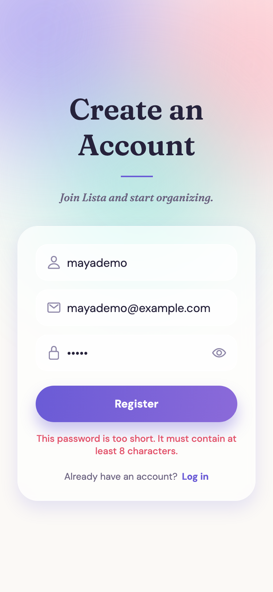

[← Back to the README](../Readme.md)

# Security

| Area | How Lista handles it |
|------|----------------------|
| Access to the API | **Everything requires a login by default**; only register, login, token refresh, password reset and reading a list's images are public |
| List permissions | Only the owner or people with **Full Access** can change, delete or share a list; **Read-Only** members cannot. Enforced on the server |
| User lookup (sharing) | Returns **only `id` and `username`** and requires login |
| Profiles | A profile can only be read or changed **by its owner** |
| Password reset | The emailed link carries a **single-use token that expires after one hour** |
| Password strength | Django's validators: **8+ characters, not common, not all digits, not similar to your details** |
| Sessions | Short-lived **access token (25 minutes)** plus a **90-day rotating refresh token** (`/token/refresh/`); used refresh tokens are blacklisted |
| New accounts | Created as **normal users**, never staff |
| Logs | **Tokens, `Authorization` headers and passwords are never logged** |
| Secrets | Keys only in environment variables; `.env`, the database, logs and uploads are **git-ignored**, and `.env.example` documents every setting |
| Dependencies | Django **5.2 LTS** and current versions; `pip-audit` reports **no known vulnerabilities** |

## Sessions and permissions

### Tokens
- `/login/` and `/register/` return an **access token** (valid **25 minutes**) and a **refresh token** (valid **90 days**).  
- Send the access token on every protected request: `Authorization: Bearer <access>`.  
- `/token/refresh/` exchanges a refresh token for a new access token. Refresh tokens **rotate**: each use returns a new one 
  and the old one is blacklisted.  

### Who can do what
| Request | Who is allowed |
|---------|----------------|
| Register, login, refresh, request/perform a password reset | Anyone |
| Read the images of a list (`get_images_for_list_item`) | Anyone (the app's image requests carry no token; image files are public URLs) |
| Everything else | A logged-in user |
| See a list | Its owner and people it is shared with |
| Change, deactivate, delete a list; upload or change its images; share it with others | Its owner and people with **Full Access** |
| Read or change a profile | Only that user |

### Known limitations (documented on purpose)
- There is no rate limiting on login or password-reset requests.  
- The reset request tells the visitor whether an email address has an account (a deliberate usability trade-off; 
  sharing and registration reveal the same thing).  
- Picture files are public web addresses: anyone who has the exact address of a picture can open it.

## Passwords and other measures

### Passwords
- Rules (from Django's `AUTH_PASSWORD_VALIDATORS`): at least 8 characters, not a commonly used password, not entirely numeric, 
  not too similar to the username or email. Enforced when **registering** and when **setting a new password through the reset link**. 
  Logging in is never checked, so existing accounts are unaffected.  

### Other measures
- Per-list permissions are enforced on the server (not only hidden in the app).  
- The request log redacts `Authorization`, cookies and any token that appears in a result.  
- `DEBUG` is off unless explicitly enabled; cookies are `Secure` when it is off.  
- Dependencies are checked with `pip-audit`.

### What the password rules look like in the app

  

